# Home sections 6–12: QA report

References: `/Users/mac/Downloads/uk/BMW (2)/Homepage/`. Each image under `report/` shows the **reference on the left** and **the build on the right**.
Desktop: 1536px, light and dark. Phone: compared at half the 2x capture width. Phone dark has no reference; it uses the light phone layout with dark colours.

## Side-by-side screenshots

### Section 6

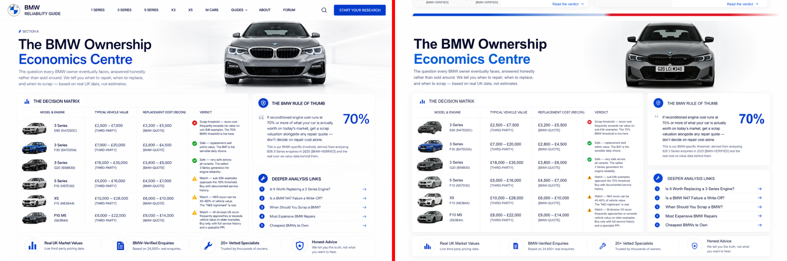

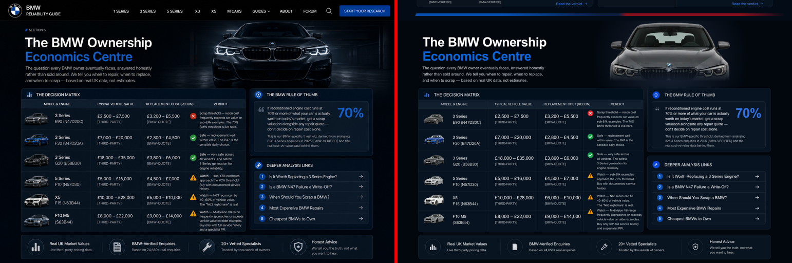

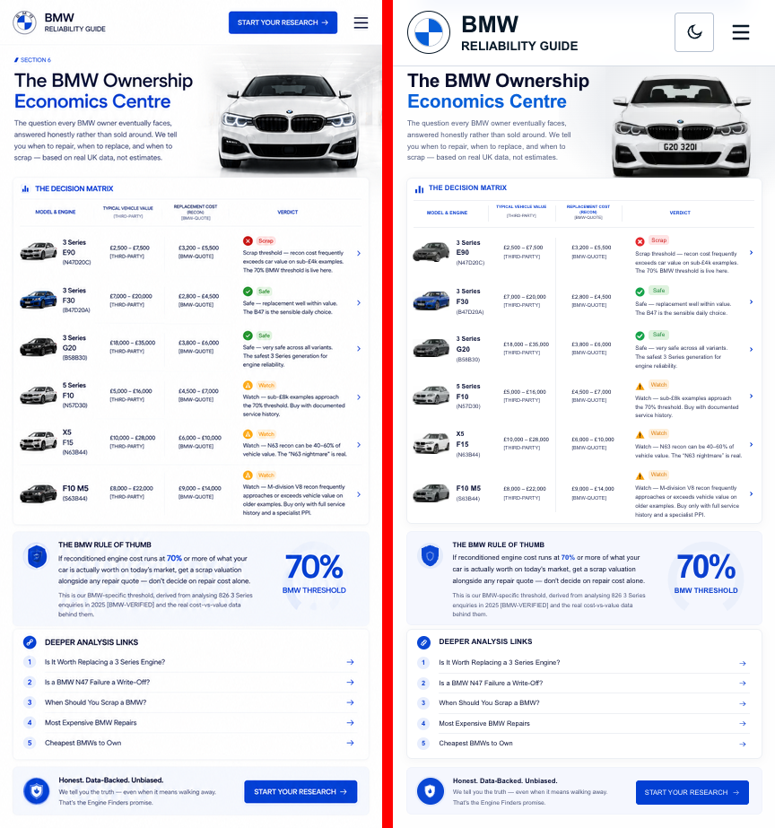

### Section 7

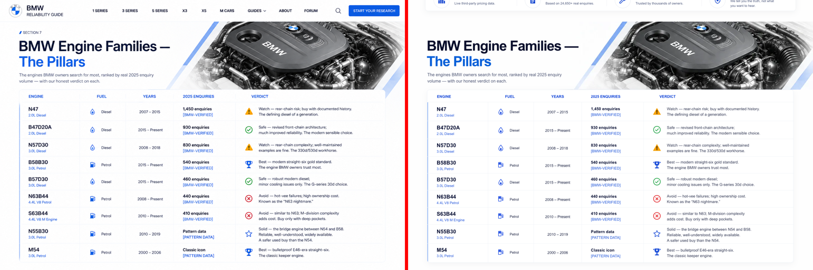

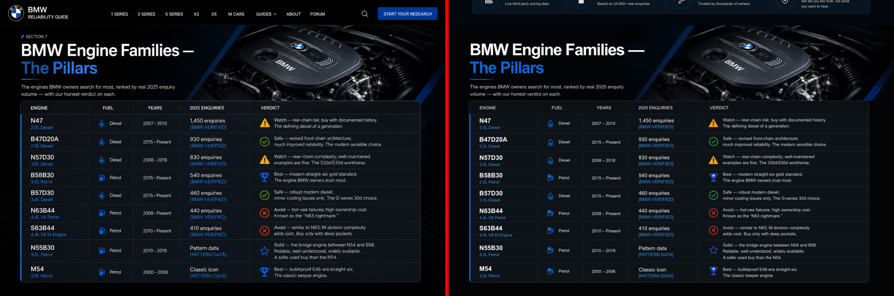

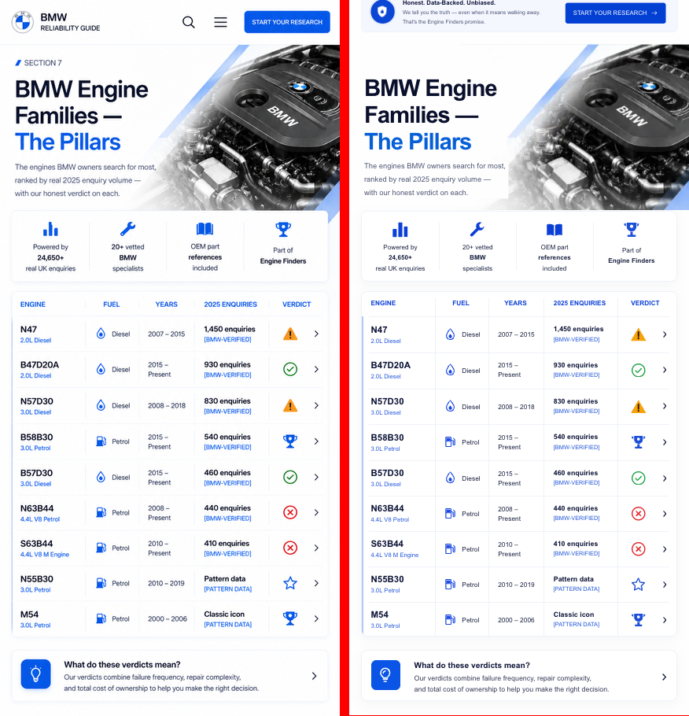

### Section 8

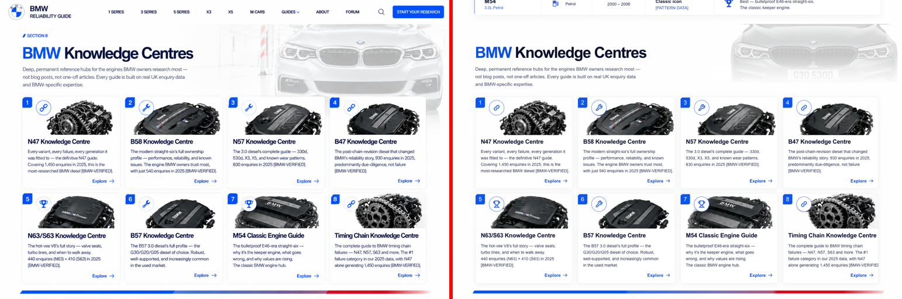

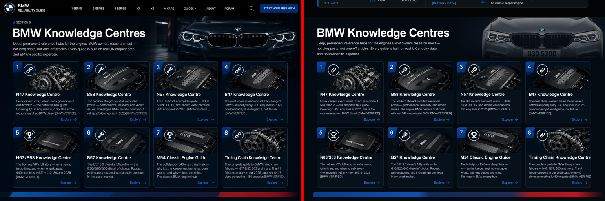

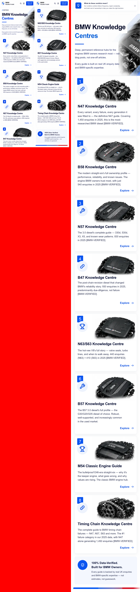

### Section 9

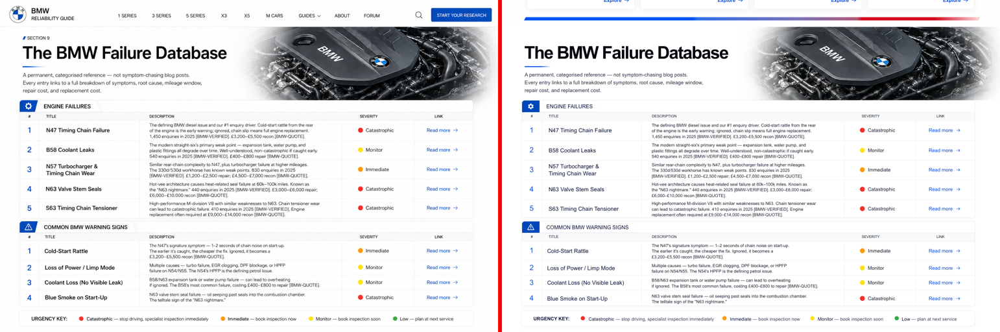

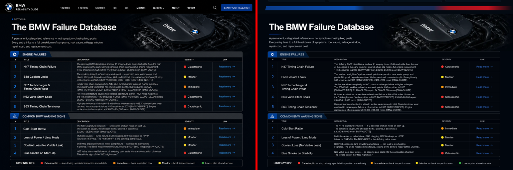

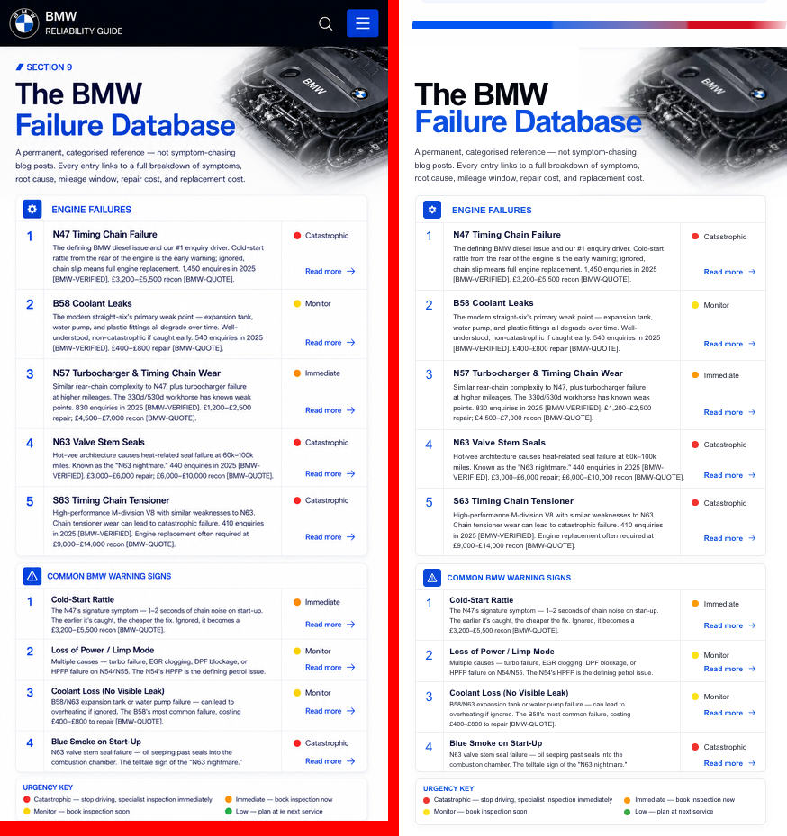

### Section 10

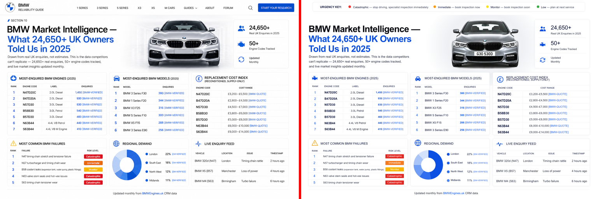

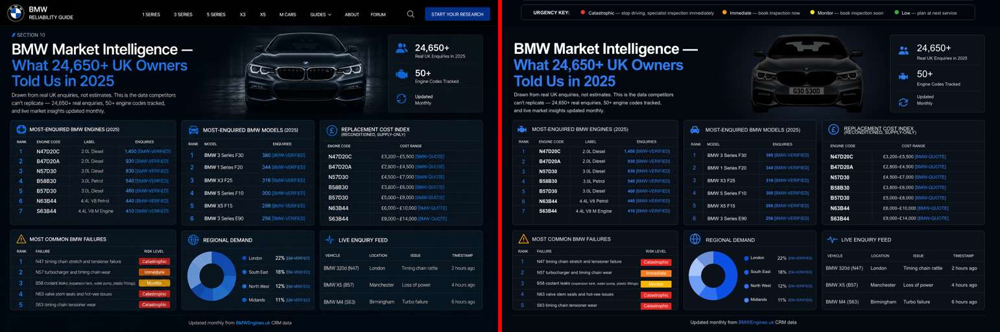

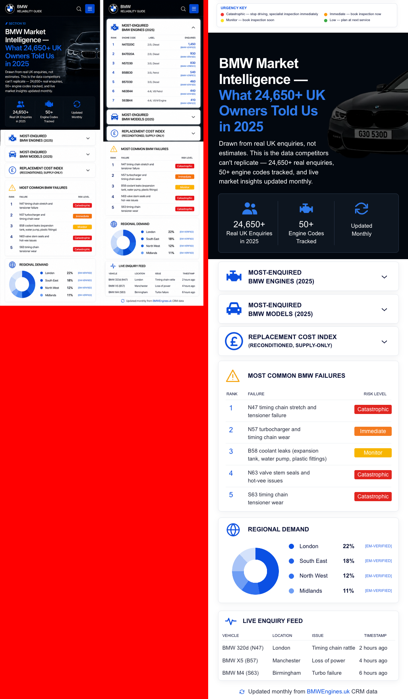

### Section 11

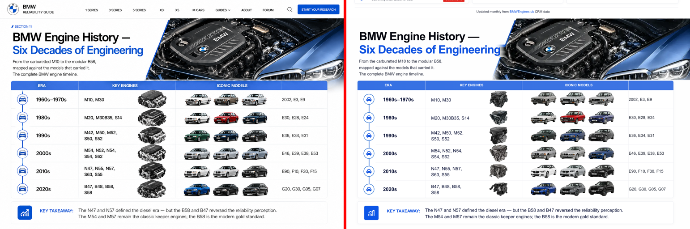

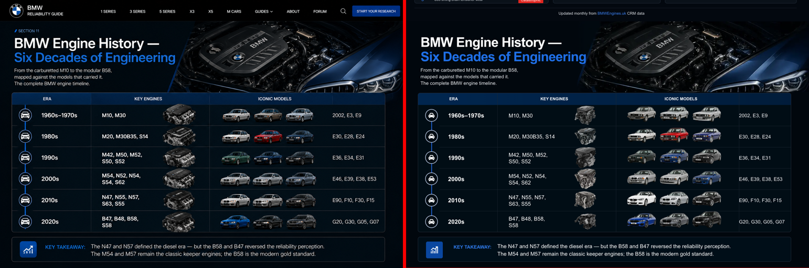

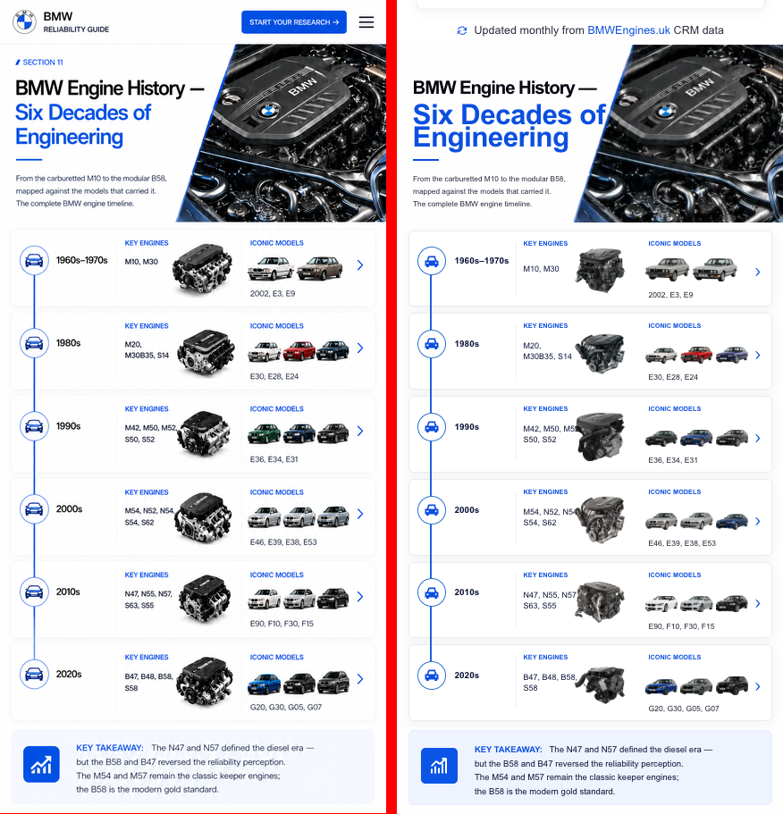

### Section 12

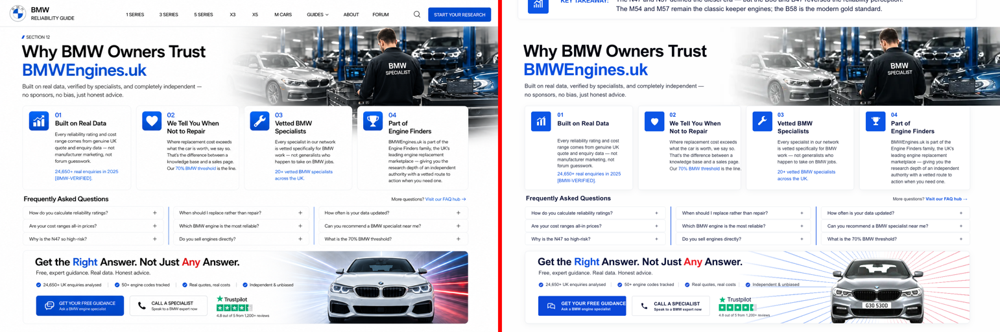

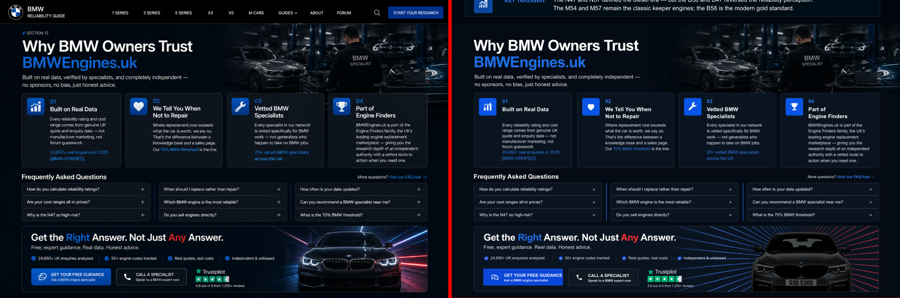

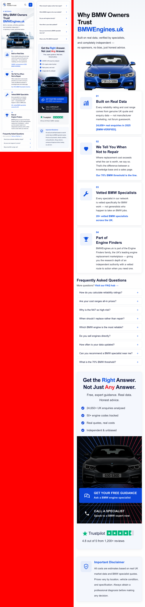

## Checklists (✅ matches / ❌ known difference)

### sec06: done (desktop light/dark 1536, phone light/dark 426)

- ✅ layout, columns, row heights, line breaks, icon sizes, card positions within ±1–2px (ink-box check).
- ❌ number plates visible on the hero and thumbnail photos (removing them would be retouching).
- ❌ No black G20 front in the folder, so dark hero and G20 thumb are Dravit Grey.
- ❌ Ref E90 thumb is silver; Graphite is used to match the desktop ref.
- ✅ The light hero backdrop (white studio room) comes from the comp (`public/home-image/sec06/car-backdrop-light.webp`, comp car inpainted out). On request, the whole car is visible from roof to wheels: roof 4px below the section top, wheels just above the cards (light 0.724 scale, dark 0.667), centred on the ref car (x 1078 light / 1060 dark at 1536). The dark theme has the ref's garage backdrop (`car-backdrop-dark.webp`), and the old bottom fade is gone. ❌ The folder photo has a higher camera angle (taller car), so keeping the whole car visible makes it narrower than the ref car: about 377 vs 402px (light) and 347 vs ~450px (dark). ❌ Dark ref headlights are lit; the folder photo's aren't.
- ❌ Font is Arial, not the ref geometric sans: sizes are matched by cap height and width, so glyph shapes differ.
- ❌ Dark headlights not lit.

### sec07: done (desktop light/dark 1536, phone light 432, phone dark = light layout with dark colours)

- ✅ columns, row heights, cap positions, icon sizes within ±1–2px (ink-box check) in both themes and on phone.
- ❌ Font is Arial, so the em dash in "Families —" runs ~9px wider on phone and glyph shapes differ.
- ❌ Pump and trophy icons are redrawn SVGs, close but not identical artwork.
- ❌ Phone dark has no reference; it reuses the desktop dark engine photo.

### sec08: done (desktop light/dark 1536, phone light 431 = both panels of 8.2, phone dark = light layout with dark colours)

- ✅ card grid, row heights, badge/circle positions, title/desc/Explore caps within ±1–3px, M-stripe.
- ❌ The ref car is a white G30 (light) and a black G30 with lit LEDs (dark); the folder only has a Sophisto Grey G30, faded with CSS opacity in light, so its number plate shows faintly.
- ❌ The ref's garage backdrop behind the car isn't available.
- ❌ Font is Arial: card titles on phone run ~3% narrower.
- ❌ Card 4 height on phone is estimated, because the ref panel cuts it off.

### sec09: done (desktop light/dark 1536, phone light 431, phone dark = light layout with dark colours)

- ✅ both tables: tab, header, row heights, number/title/description/severity/link caps within ±1–2px, divider x, urgency key.
- ❌ Font is Arial, so description line widths vary by 1–4% and table-2 titles are ~3% narrower.
- ❌ Phone-dark has no reference.

### sec10: done (desktop light/dark 1536, phone 503 vs 10.2 panel 1 and panel 2 for the opened engines table, phone dark = all-dark)

- ✅ six card positions, card internals (titles, headers, rows, pills, donut, legend, feed) within ±1–3px, stats card, footer, phone hero/stats/accordions/failures/regional/feed.
- ✅ The car backdrop (studio in light, dark garage in dark and phone) comes from the comps (`public/home-image/sec10/car-backdrop-{light,dark,phone}.webp`, comp car inpainted out). The folder car is sized to the ref car's width and centre. ❌ The ref car is a silver G30 (light) and a black G30 (dark); only a Sophisto Grey G30 exists, so a CSS brightness filter plus a cool tint brings it toward silver and black (source untouched). Its number plate shows, and the folder photo is a slightly higher camera angle.
- ❌ Font is Arial, so some labels run 3–7% wider or narrower.
- ❌ The phone panels in the ref disagree with each other (card inset 25 vs 18, failures height); panel 1 is followed.
- ❌ Donut segment shades are matched visually; the ref donut doesn't follow the listed percentages.

### sec11: done (desktop light/dark 1536, phone light 432, phone dark = light layout with dark colours)

- ✅ table geometry (header band, 6 rows, dividers, timeline circles), era/engine/model text caps within ±1–2px, car slots (x, width, bottom), key-takeaway card, phone era cards.
- ❌ The folder has no 2002, E3, E9, E31, E38, so row 1 uses E12/E28 and row 3 uses E39; colours follow the ref (silver/beige/silver, white/red/blue, green/blue/black, silver/silver/light-blue, white/silver/black, blue/dark/black SUV).
- ❌ Car photos are the folder's 45° shots, which sit lower and longer than the ref thumbnails.
- ❌ Engine renders are different artwork from the ref's.
- ❌ Font is Arial.

### sec12: done (desktop light 12.2 / dark 12 at 1536, phone light 388 vs both 12.4 panels, phone dark = light layout with dark colours)

- ✅ heading, four trust cards, FAQ grid and separators, CTA band (heading, stats, two buttons, Trustpilot), phone cards/FAQ/CTA/disclaimer within ±1–6px.
- ❌ The ref CTA car is a white (light) or black-with-lit-LEDs (dark) G30; the folder only has Sophisto Grey, so a CSS brightness filter is used and the plate shows.
- ✅ The CTA light-trail backdrop is taken from the comps (`public/home-image/sec12/cta-streaks-{light,dark,phone}.webp`, with the comp's car inpainted out). The folder car sits at the ref car's size and position, with a CSS blue/red reflection tint clipped to the car shape.
- ❌ The two ref phone panels use different FAQ item heights (39 vs 58px); panel 1 is followed.
- ❌ The ref phone hero shows a city backdrop that isn't available.
- ❌ Font is Arial.

## Car usage

| Section | Local file (`public/cars/home/`) | Source file (`bmw split/`, untouched) |
|---|---|---|
| sec06 | `sec06-hero-light` | bmw-3 series-g20 lci-m340i xdrive-saloon-2022–-new-frozen pure grey-g20 lci m340-front-view.webp |
| sec06 | `sec06-hero-dark` | bmw-3 series-g20-330d xdrive m sport-saloon-2019–-new-dravit grey-g20 330d.png-front-view.webp |
| sec06 | `sec06-hero-phone` | bmw-3 series-g20-320i m sport-saloon-2019–-new-mineral white-g20 320i-front-view.webp |
| sec06 | `sec06-e90` | bmw-3 series-e90-320d se-saloon-2005–2008-new-sparkling graphite-e90 320d-45-angle-front-view.webp |
| sec06 | `sec06-f30` | bmw-3 series-f30 lci-320d m sport-saloon-2015–2018-new-estoril blue-f30 lci 320d-45-angle-front-view.webp |
| sec06 | `sec06-g20` | bmw-3 series-g20-330d xdrive m sport-saloon-2019–-new-dravit grey-g20 330d.png-45-angle-front-view.webp |
| sec06 | `sec06-f10` | bmw-5 series-f10 lci-520d m sport-saloon-2013–2016-new-glacier silver-f10 lci 520d-45-angle-front-view.webp |
| sec06 | `sec06-f15` | bmw-x5-f15-xdrive30d m sport-suv-2013–2018-new-mineral white-f15 m sport-45-angle-front-view.webp |
| sec06 | `sec06-m5` | bmw-m5-f10 lci-m5 competition-saloon-2014–2016-new-singapore grey-f10 comp-45-angle-front-view.webp |
| sec08 | `sec08-hero-light` | bmw-5 series-g30-530d m sport-saloon-2017–2020-new-sophisto grey-g30 530d-front-view.webp |
| sec10 | `sec10-hero` | bmw-5 series-g30-530d m sport-saloon-2017–2020-new-sophisto grey-g30 530d-front-view.webp |
| sec10 | `sec10-hero-cut` | bmw-5 series-g30-530d m sport-saloon-2017–2020-new-sophisto grey-g30 530d-45-angle-front-view.webp |
| sec11 | `sec11-r1a` | bmw-5 series-e12-520i-saloon-1972–1981-new-polaris silver-e12 520i-45-angle-front-view.webp |
| sec11 | `sec11-r1b` | bmw-5 series-e28-535i-saloon-1981–1987-new-lachssilber-e28 535i-45-angle-front-view.webp |
| sec11 | `sec11-r1c` | bmw-5 series-e12-m535i-saloon-1980–1981-special-polaris silver-e12 m535i-45-angle-front-view.webp |
| sec11 | `sec11-r2a` | bmw-3 series-e30-318i-saloon-1982–1991-new-alpine white-e30 318i-45-angle-front-view.webp |
| sec11 | `sec11-r2b` | bmw-5 series-e28-520i-saloon-1981–1987-new-zinnober red-e28 520i-45-angle-front-view.webp |
| sec11 | `sec11-r2c` | bmw-5 series-e34-m5 3.6-saloon-1988–1992-new-macao blue-e34 m5 -45-angle-front-view.webp |
| sec11 | `sec11-r3a` | bmw-3 series-e36-328i sport-saloon-1995–1998-new-oxford green-e36 328i-45-angle-front-view.webp |
| sec11 | `sec11-r3b` | bmw-3 series-e36-325i sport-saloon-1991–1995-new-montreal blue-e36 325i-45-angle-front-view.webp |
| sec11 | `sec11-r3c` | bmw-5 series-e39-m5 individual-saloon-2001–2003-special-carbon black-e39 m5 ind-45-angle-front-view.webp |
| sec11 | `sec11-r4a` | bmw-3 series-e46-318i 320d se-saloon-1998–2001-new-titanium silver-e46 se-45-angle-front-view.webp |
| sec11 | `sec11-r4b` | bmw-5 series-e39-530d sport-saloon-1998–2000-new-titanium silver-e39 530d-45-angle-front-view.webp |
| sec11 | `sec11-r4c` | bmw-3 series-e46-330d sport-saloon-2000–2005-new-topaz blue-e46 330d-45-angle-front-view.webp |
| sec11 | `sec11-r5a` | bmw-3 series-f30-330d m sport-saloon-2012–2015-new-mineral white-f30 330d-45-angle-front-view.webp |
| sec11 | `sec11-r5b` | bmw-5 series-f10 lci-520d m sport-saloon-2013–2016-new-glacier silver-f10 lci 520d-45-angle-front-view.webp |
| sec11 | `sec11-r5c` | bmw-5 series-f10-550i m sport-saloon-2010–2013-new-carbon black-f10 550i-45-angle-front-view.webp |
| sec11 | `sec11-r6a` | bmw-3 series-g20-m340i xdrive-saloon-2019–-new-portimao blue-m340i-45-angle-front-view.webp |
| sec11 | `sec11-r6b` | bmw-5 series-g30-530d m sport-saloon-2017–2020-new-sophisto grey-g30 530d-45-angle-front-view.webp |
| sec11 | `sec11-r6c` | bmw-x5-g05-xdrive40d m sport-suv-2020–2023-new-carbon black-g05 40d-45-angle-front-view.webp |
| sec12 | `sec12-cta` | bmw-5 series-g30-530d m sport-saloon-2017–2020-new-sophisto grey-g30 530d-front-view.webp |
| sec12 | `sec12-phone` | bmw-3 series-f30 lci-320d m sport-saloon-2015–2018-new-estoril blue-f30 lci 320d-front-view.webp |

`-cut` copies are the same photo with only the white backdrop removed (rembg), used on dark surfaces. Nothing was mirrored, recoloured in the file, or cropped in the file; all cropping is CSS (bbox-driven).

## Shared changes

- **New** `src/components/home/ScaleBox.js`, used only by HomeSec6–12. It renders each section at its design width (1536 desktop / ~430 phone) and scales it to the viewport, so measured px stay proportional at every width.
- No changes to `globals.css`, `page.js`, Navbar/Footer, shared components, `VerdictGlyph`, or HomeSec1–5 / homeSec1–5.json. All of those files were last modified before this task started.
- Breakpoint for sections 6–12: phone layout below 1024px (scaled up to 1.5× and centred on tablets), desktop layout from 1024px (scaled 0.67–1.0×, centred above 1536).

## Full-page pass

- No horizontal scroll at 390 / 768 / 1024 / 1280 / 1536 / 1920 in either theme (`scrollWidth == clientWidth`, no element past the right edge).
- The theme toggle switches `data-theme`, and sections re-render with their dark/light spec (checked on section 11's background).
- Section heights at 1536: 965 / 944 / 942 / 942 / 947 / 942 / 942 px (sec6–12).

## Open questions

- sec07: the engine-bay header photo exists only inside the reference comps. It's used as a crop of the comp for now; please supply the original photo if one exists.
- sec08: the eight engine photos and the phone header photo are also crops of the comps. The folder has no white or black G30 front, so the Sophisto Grey G30 is used in both themes.
- sec09: the engine-bay header photo is also a crop of the comps.
- sec10: CSS brightness filter on the G30 hero (lighter in light theme, darker in dark) to get closer to the ref car colour; the source file is untouched. Is that acceptable, or do you prefer the unfiltered grey car? (The same applies to the sec12 CTA car.)
- sec12: the workshop photo ("BMW SPECIALIST" mechanic) is a crop of the comps.

- Number plates are visible on the folder photos (hero and thumbnail cars). Removing them would mean retouching the source, which isn't allowed. Should they stay, or may a separate plate-less copy be made?
- The font is Arial site-wide; the references use a geometric sans. Sizes are matched by cap height, but glyph widths differ by 1–7%. Changing the site font would alter the approved sections 1–5.
- No reference car has its headlights lit in the dark theme, and the folder has no lit-headlight photos.
